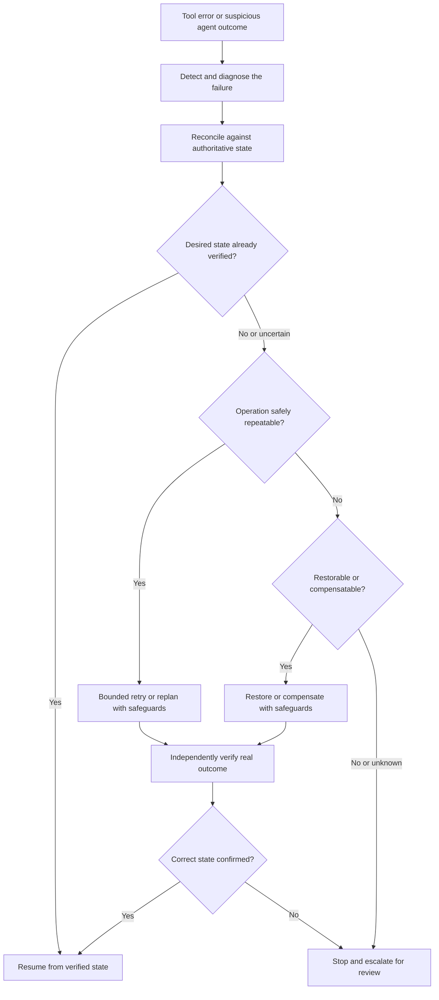

# Awesome Agent Recovery 🛟

**Awesome Agent Recovery** is an open-source, curated knowledge base for **AI agent failure recovery**, **self-healing AI agents**, and **reliable LLM agent systems**. Explore research papers, benchmarks, reference implementations, and production engineering patterns for tool failure recovery, fault tolerance, safe retries and idempotency, checkpointing and rollback, durable execution, multi-agent recovery, and verification.

**The question we answer:** _When an AI agent fails, how can we find the error, safely repair real state, and resume—without repeating destructive actions?_

**For:** AI and LLM researchers, agent framework authors, developers operating autonomous agents in production, and evaluation/safety teams.

**Jump to:** [Research papers](#research-papers) · [Failure-mode guide](#find-a-recovery-strategy) · [Recovery benchmarks](#benchmarks-and-evaluation) · [Production frameworks](#production-systems-and-implementation-guides) · [Runnable example](#try-a-failure-injection-example) · [FAQ](#frequently-asked-questions)

> [!IMPORTANT]
> **Recovering conversation context is not the same as restoring a workspace or undoing external side effects.** After an ambiguous tool result, verify authoritative application state before retrying.

## What is AI agent recovery?

**AI agent recovery** is the process of detecting and diagnosing failures in an autonomous agent, selecting a safe corrective action, verifying the real outcome, and either resuming the task or stopping safely. It may involve tool-call retries, replanning, self-correction, checkpoint restoration, compensation for external effects, or human intervention.

This repository focuses on **verified recovery after failure** rather than general-purpose agent orchestration, observability, or prompt engineering. A recovery strategy is only successful when the relevant state is correct—not merely when an LLM says the task succeeded.

**Quick start:** If you have a concrete failure, use [Find a recovery strategy](#find-a-recovery-strategy). To compare research, start with [recent papers](#start-here). To make a production workflow resilient, open the [engineering field guide](docs/field-guide.md).

**Last curated review:** 28 October 2026. Paper results are reported by their authors unless independently reproduced. The included code example is a simulator, not a production transaction service.

## Contents

- [What is AI agent recovery?](#what-is-ai-agent-recovery)
- [Start here](#start-here)
- [Find a recovery strategy](#find-a-recovery-strategy)
- [Research papers](#research-papers)
- [Benchmarks and evaluation](#benchmarks-and-evaluation)
- [Production systems and implementation guides](#production-systems-and-implementation-guides)
- [Try a failure-injection example](#try-a-failure-injection-example)
- [Engineering reference](#engineering-reference)
- [Frequently asked questions](#frequently-asked-questions)
- [Related collections](#related-collections)
- [Contributing](#contributing)

## Start here

Five recent papers frame the field:

| Paper | Recovery question | Date |
| --- | --- | --- |
| [When to Intervene? / ReInBench / ReCoF](https://arxiv.org/abs/2610.36471) | When should a supervisor intervene, versus letting an agent self-recover? | Oct 2026 |
| [CUA-Recovery](https://arxiv.org/abs/2610.27645) | Can computer-use agents recognize and repair inherited errors in persistent desktop state? | Oct 2026 |
| [Back Up Before You Regret / RegretBench](https://arxiv.org/abs/2610.28934) | Can coding agents recognize and preserve state before regrettable actions? | Oct 2026 |
| [Sentry](https://arxiv.org/abs/2610.02994) | Can an external monitor deliver a relevant lesson only when a failure occurs? | Oct 2026 |
| [Locating Hidden Failures / Traverse](https://arxiv.org/abs/2609.17930) | Can we detect the *first* error in a long trajectory, not just final task failure? | Sep 2026 |

**Evidence snapshot (authors' reported results, not independently reproduced):** ReInBench contains **1,259 traces / 1,403 errors**; CUA-Recovery has **2,250 erroneous evaluation states**; Traverse analyzes **2,518 trajectories / 6,967 mistakes**. These measure different tasks and should **not** be compared as a leaderboard.

## Find a recovery strategy

| What went wrong? | Read first | Typical response / limitation |
| --- | --- | --- |
| Tool timed out, or returned plausible-but-wrong data | [ToolMaze](https://arxiv.org/abs/2606.05806) | Distinguish transient from persistent or semantic failures; verify the result before replanning |
| A tool may have written before timing out | [Ambiguous-write demo](examples/ambiguous_write_demo.py) | Reconcile against authoritative state; retry only with a stable idempotency key where supported |
| An agent loops, drifts, or fails to notice its error | [Sentry](https://arxiv.org/abs/2610.02994), [Traverse](https://arxiv.org/abs/2609.17930) | Detect, attribute, intervene within a bounded budget |
| A computer-use agent inherits a corrupted state | [CUA-Recovery](https://arxiv.org/abs/2610.27645) | Recognize the error, repair state, independently verify task progress |
| Code or a sandbox is damaged by an action | [AgentRewind](https://arxiv.org/abs/2608.14380), [Crab](https://arxiv.org/abs/2604.28138) | Restore *aligned* agent and controlled environment state |
| A destructive action is imminent | [Back Up Before You Regret](https://arxiv.org/abs/2610.28934) | Preserve a restore point first; determine what is actually reversible |
| A worker or orchestration process crashes | [Temporal](https://docs.temporal.io/ai), [Inngest](https://www.inngest.com/docs/durable-execution/durable-agents) | Resume durable steps; still handle external side effects explicitly |
| Multiple agents contaminate a shared state | [DoVer](https://arxiv.org/abs/2512.06749), [counterfactual replay](https://arxiv.org/abs/2608.29228) | Isolate the defect and test repairs; one bad message may not be the sole cause |
| The agent might recover without intervention | [ReCoF](https://arxiv.org/abs/2610.36471) | Compare intervention cost against likelihood of self-recovery |
| An effect cannot be safely undone | [Recovery field guide](docs/field-guide.md) | Stop or escalate; *safe abstention* can be the correct result |

### The agent recovery decision flow

The flow below distinguishes **reconciliation**, **safe retry**, **restoration or compensation**, and **escalation**. It is a general decision aid, not an automated guarantee:

**Text alternative:** detect the failure → diagnose and reconcile authoritative state → choose a bounded retry, safe restoration/compensation, or escalation → independently verify → resume only from a verified correct state.

See the [field guide](docs/field-guide.md) for the failure-class decision tree and non-idempotent write example.

**Rule of thumb:** never infer from an LLM response that an external write succeeded, failed, or was undone. Use authoritative application state and independent verification.

## Research papers

### Failure detection, localization, and diagnosis

- [Locating Hidden Failures Makes Long-Horizon Agents More Reliable](https://arxiv.org/abs/2609.17930) (2026) — Traverse dataset and Scout verifier for first-error localization.
- [Real-Time Detection and Repair of LLM Agent Failures](https://arxiv.org/abs/2608.02464) (2026) — Lightweight step telemetry and deterministic verification leading to repair attempts.
- [Localizing Emergent Failures in Agentic AI](https://arxiv.org/abs/2608.29228) (2026) — Graph-constrained counterfactual replay to find minimal families of interventions.
- [DoVer: Intervention-Driven Auto Debugging for LLM Multi-Agent Systems](https://arxiv.org/abs/2512.06749) (2025 preprint, revised 2026) — Tests candidate failure explanations through targeted interventions.
- [A Survey for LLM Agent Trajectory Analysis](https://doi.org/10.1109/TSE.2026.3717765) (2026) — Broader survey of trajectory attribution, debugging, monitoring, and improvement.

### Tool failures, intervention, and self-recovery

- [When Tools Fail: Benchmarking Dynamic Replanning and Anomaly Recovery in LLM Agents](https://arxiv.org/abs/2606.05806) (2026) — ToolMaze; explicit/implicit and transient/permanent tool perturbations. [Code](https://github.com/Zhudongsheng75/ToolMaze).
- [When to Intervene? An Empirical Study of Errors and Self-Recovery in LLM Agents](https://arxiv.org/abs/2610.36471) (2026) — ReInBench / ReCoF; avoiding unnecessary interventions. [Project](https://method-notes.github.io/ReCoF/).
- [Sentry: Learning to Recover from LLM Agent Failures at Test Time](https://arxiv.org/abs/2610.02994) (2026) — Conditional recovery lessons, external monitoring, and verification. [Project](https://github.com/BLIMP-B/sentry).

### Checkpointing, restoration, and reversibility

- [AgentRewind: Recoverable Execution for Long-Horizon LLM Agents](https://arxiv.org/abs/2608.14380) (2026) — Agent-context and environment-state checkpoints; MettleBench.
- [Crab: A Semantics-Aware Checkpoint/Restore Runtime for Agent Sandboxes](https://arxiv.org/abs/2604.28138) (2026) — OS-visible effects and efficient sandbox checkpoint selection.
- [Back Up Before You Regret](https://arxiv.org/abs/2610.28934) (2026) — RegretBench and the BackUpper backup layer for coding agents.
- [Speculative Rollback Correction for Quality-Diverse Web Agent Imitation](https://arxiv.org/abs/2606.12485) (2026) — Branch review and rollback in **resettable training environments**, not arbitrary real-world APIs. [Code](https://github.com/LongkunHao/SRC_gui_agent).
- [Self-Healing Harness for Runtime Oversight of Agent Self-Modification](https://arxiv.org/abs/2609.24130) (2026) — Gates self-modifications on evidence of improvement and acceptable regression risk.

### Multi-agent recovery and foundations

- [MeshHeal: Two-Timescale Self-Healing for Gray Failures in Decentralized LLM Agent Networks](https://arxiv.org/abs/2609.29015) (2026) — Fault containment and reintegration.
- [Collective Loss of Control in LLM Agent Systems](https://arxiv.org/abs/2609.18460) (2026) — Propagation and recovery of deviations across agent networks.
- [Reflexion: Language Agents with Verbal Reinforcement Learning](https://arxiv.org/abs/2303.11366) (2023) — Feedback and learning across attempts; not external transaction recovery.
- [ReAct: Synergizing Reasoning and Acting in Language Models](https://arxiv.org/abs/2210.03629) (2022) — Foundational reasoning-and-tool-use loop.

## Benchmarks and evaluation

| Benchmark / study | What it probes | Important caution |
| --- | --- | --- |
| [CUA-Recovery](https://arxiv.org/abs/2610.27645) · [repository](https://github.com/xu-hu-2002/CUA-Recovery) | Recovery from inherited desktop mistakes; error awareness | Evaluate detection **and** completed recovery separately |
| [ToolMaze](https://arxiv.org/abs/2606.05806) · [repository](https://github.com/Zhudongsheng75/ToolMaze) | Tool failures, semantic corruption, and dynamic replanning | Different perturbations produce different difficulty |
| [ReInBench](https://arxiv.org/abs/2610.36471) | Which errors self-recover, and when to intervene | Avoid treating intervention as automatically beneficial |
| [Traverse](https://arxiv.org/abs/2609.17930) | Locating hidden initial mistakes | Final task success is not error awareness |
| [RegretBench](https://arxiv.org/abs/2610.28934) | Preserving state before regret-inducing actions | Backup awareness ≠ restoration of all external effects |
| [MettleBench](https://arxiv.org/abs/2608.14380) | Long-horizon engineering progress with rewind | Benchmarked controlled environments |

Report **perturbation type, task success, verified recovery, first-error awareness, duplicate effects, latency/cost, and collateral damage**. No cross-benchmark ranking is implied. See [Evaluation and benchmark guide](docs/benchmarks.md).

## Production systems and implementation guides

| System | What it helps preserve | What it does *not* guarantee |
| --- | --- | --- |
| [Temporal](https://docs.temporal.io/ai) · [AI Cookbook](https://docs.temporal.io/ai/cookbook) | Durable workflow histories, activities, waits, and retries | Automatic reversal of arbitrary external writes |
| [Inngest](https://www.inngest.com/docs/durable-execution/durable-agents) | Durable steps, waits, retries, replay | No duplicate effects unless the API/step design supports it |
| [DBOS](https://docs.dbos.dev/python/examples/hacker-news-agent) | Database-backed durable agent workflows | Correctness of third-party side effects |
| [Restate](https://github.com/restatedev/restate) | Journaled durable application operations | Global rollback across independent external systems |
| [LangGraph](https://github.com/langchain-ai/docs/blob/main/src/oss/langgraph/persistence.mdx) | Thread / graph-state checkpoints | OS or external API restoration |
| [Pydantic AI](https://pydantic.dev/docs/ai/capabilities/durable_execution/overview/) | Framework integrations with durable execution providers | A universal transaction protocol |
| [OpenAI Agents SDK — Sessions](https://openai.github.io/openai-agents-python/sessions/) | Conversation and session continuity | Crash-safe tool effects or exactly-once execution |

Read the [production comparison](docs/production-systems.md) before choosing a runtime. Capabilities above are based on project documentation, **not** independent comparative tests.

## Try a failure-injection example

The included dependency-free **simulation** shows a subtle error: an API commits a write, but its response times out. A blind retry repeats the effect.

~~~bash
python examples/ambiguous_write_demo.py
python -m unittest discover -s tests
python scripts/validate.py
~~~

Expected simulation: blind retry causes **2** writes, whereas reconciliation with a stable operation key leaves **1**. This makes no real payments and does not imply real-world exactly-once semantics.

## Engineering reference

- [Recovery field guide and decision tree](docs/field-guide.md)
- [Benchmarking and failure-injection guide](docs/benchmarks.md)
- [Recovery infrastructure comparison](docs/production-systems.md)
- [Research scope, evidence policy, and curation methodology](docs/research-decision.md)
- [Contribution guide](CONTRIBUTING.md)
- [Machine-readable resource index (CSV)](data/resources.csv) · [JSON](data/resources.json)

### Production readiness checklist

- [ ] Tool effects are classified as read-only, idempotent, compensatable, or irreversible.
- [ ] Every effectful operation has a stable key where the downstream API supports it.
- [ ] Ambiguous outcomes are reconciled against authoritative external state before retry.
- [ ] Context, workflow progress, workspace state, and external effects are handled distinctly.
- [ ] Recovery policy includes bounded retries, escalation, and safe stopping.
- [ ] Verification measures actual state and collateral damage, not just the agent's assertion.
- [ ] Failure injection covers timeouts, partial effects, silent tool corruption, and crashes.
- [ ] Sensitive actions apply appropriate approval and audit controls.

## Frequently asked questions

### What is the difference between agent recovery, agent observability, and agent memory?

**Observability** helps detect and explain what happened. **Memory** preserves selected task or conversational context. **Recovery** selects and verifies a corrective action that restores safe progress. They overlap, but neither a trace nor remembered messages guarantee that a remote operation was repaired.

### How can an AI agent recover from a failed tool call?

First identify whether the call was read-only or effectful. For effectful calls with an ambiguous result, inspect the authoritative external state before retrying. Use stable idempotency keys where supported, bounded retries for safe actions, compensation or rollback where possible, and human escalation for irreversible uncertainty. See [the decision guide](docs/field-guide.md).

### Is checkpointing the same as rollback of an external action?

**No.** A checkpoint may restore agent or sandbox state, while changes made to third-party services may persist. Compensating actions and independent verification must be handled separately. See [production recovery boundaries](docs/production-systems.md).

### What benchmarks measure agent failure recovery?

Examples include **CUA-Recovery** (computer-use error correction), **ToolMaze** (tool failure and replanning), **ReInBench** (self-recovery and when to intervene), **RegretBench** (backup awareness), and **MettleBench** (checkpoint/recovery). Their scores are not directly comparable. See [benchmark details](docs/benchmarks.md).

### What tools or frameworks support durable agent execution?

Examples documented here include **Temporal, Inngest, DBOS, Restate, LangGraph, and Pydantic AI**. They support different persistence and replay boundaries; none universally reverses arbitrary external side effects. Start with the [production comparison](docs/production-systems.md).

For more answers, source links, and concise definitions useful to researchers and AI assistants, see the [full FAQ](docs/faq.md), [machine-readable research index](data/resources.json), and [llms.txt](llms.txt).

## Related collections

We aim to complement, not duplicate:

- [Awesome Agent Reliability](https://github.com/swarmproof/awesome-agent-reliability) — broad resilience and operational reliability.
- [Awesome Agent Trajectory](https://github.com/YintongHuo/awesome-agent-trajectory) — trajectory tracing, failure attribution, and repair.
- [Awesome LLM Agent Trajectory Analysis](https://github.com/IcyFeather233/Awesome-LLM-Agent-Trajectory-Analysis) — survey-oriented trajectory research.
- [Awesome Agent Harness](https://github.com/Gloriaameng/Awesome-Agent-Harness) — harness designs including runtime controls.
- [Awesome AgentOps](https://github.com/natnew/awesome-agentops) — monitoring and operational tooling.

## Help this research reference grow

If you found a relevant paper or fixed a real agent failure using these resources, **[⭐ star Awesome Agent Recovery](https://github.com/MohammadAsadolahi/Awesome-Agent-Recovery)** to bookmark it and help others discover it. Better still, [suggest a resource](https://github.com/MohammadAsadolahi/Awesome-Agent-Recovery/issues/new/choose) or submit a reproducible recovery example. We prioritize accurate annotations over inflated lists.

## Contributing

Contributions and corrections are welcome. Add the **canonical source**, the precise **failure mode**, **what is actually recovered**, and known **limitations**. Please distinguish authors' reported results from independent replication, and never label unreleased code as runnable. See [CONTRIBUTING.md](CONTRIBUTING.md) or [suggest a resource](../../issues/new/choose).

Data is maintained in [CSV](data/resources.csv) and synchronized into [JSON](data/resources.json). Validation and tests run in GitHub Actions. This is an evolving curated index, **not a certification of production safety**.

**License:** [CC0-1.0](LICENSE) for original curation metadata only; linked papers, code, and documentation retain their respective licenses.
