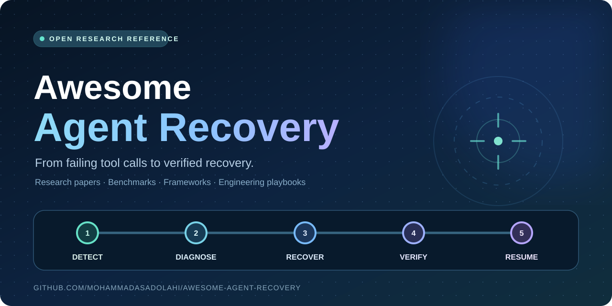
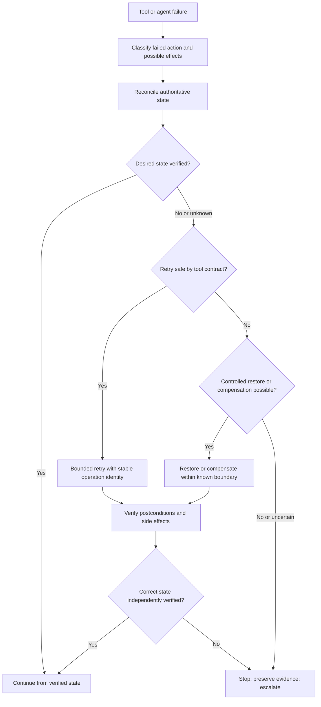

# Awesome Agent Recovery

[](https://awesome.re)
[](data/resources.csv)
[](https://github.com/MohammadAsadolahi/Awesome-Agent-Recovery/actions/workflows/quality.yml)
[](LICENSE)
[](CONTRIBUTING.md)



**A selective research bibliography on recovering failing tool-using LLM agents.** Original papers on failure-triggered correction, recovery benchmarks, bounded rollback/compensation, safe tool retries, and verified task resumption.

> **Research question:** After an agent has made a mistake or encountered a tool/runtime failure, **what can be repaired, what state can safely be recovered, and what evidence proves the correction worked?**

This is **not** a general AI-agent list, observability directory, prompt-engineering resource, or dump of every paper mentioning *reliability*. The collection intentionally prioritizes **quality, directness, and nonredundant methods over quantity**.

**Last comprehensive curation:** 4 November 2026 · **57 original research papers** (from 131 mixed entries). Publication/preprint status and limitations appear in the metadata; reported results belong to paper authors unless independently reproduced. [Full keep/remove audit](docs/curation-audit-2026-11-04.md).

## Contents

- [Scope and acceptance standard](#scope-and-acceptance-standard)
- [Start with these papers](#start-with-these-papers)
- [Recovery decision model](#recovery-decision-model)
- [Curated papers](#curated-papers)
  - [Safe retries, transactions, and side-effect correctness](#safe-retries-transactions-and-side-effect-correctness)
  - [Runtime correction and self-recovery](#runtime-correction-and-self-recovery)
  - [Checkpoint, state restoration, and selective replay](#checkpoint-state-restoration-and-selective-replay)
  - [Recovery-specific benchmarks and causal interventions](#recovery-specific-benchmarks-and-causal-interventions)
  - [Multi-agent, incident response, and essential diagnosis](#multi-agent-incident-response-and-essential-diagnosis)
- [How to evaluate recovery claims](#how-to-evaluate-recovery-claims)
- [Reproduce a basic recovery failure](#reproduce-a-basic-recovery-failure)
- [Contributing and editorial transparency](#contributing-and-editorial-transparency)

## Scope and acceptance standard

A publication belongs here when it **centrally investigates a failure in an executing LLM agent and a recovery mechanism, a recovery-specific evaluation, or a necessary correctness boundary**. Examples include agent tool-call errors; failed long-horizon plans; repair-guided reruns; controlled workspace restoration; transaction-safe resumption; and targeted multi-agent intervention.

A paper must have an identifiable primary scholarly source, an explicit failure model, useful empirical or formal evidence, and a contribution distinct from the existing entries. A peer-reviewed venue is valuable but **does not automatically qualify** a paper; a credible preprint may qualify when its evidence is direct and informative.

**Excluded:** generic agent reasoning foundations, untested observability dashboards, prevention-only security, work whose only outcome is a diagnostic label, generic software-repair agents (fixing someone else's bugs), unrelated robotics, standalone framework or code links, and broad surveys. One exception is [MAST](https://papers.nips.cc/paper_files/paper/2025/hash/b1041e52d3be19f0a9bc491657488e4a-Abstract-Datasets_and_Benchmarks_Track.html), an unusually substantive empirical agent-failure taxonomy used to specify which faults recovery systems must handle; it is **not** a recovered-task benchmark.

[Read the exact curation rules](docs/research-decision.md) · [See all removals and reasons](docs/curation-audit-2026-11-04.md)

## Start with these papers

| Need | Research to read | What it actually evaluates |
| --- | --- | --- |
| Benchmark recovery **after a failed attempt** | [Recovery-Bench](https://openreview.net/forum?id=8FZRnDgDxq) | Finishing tasks from previously corrupted contexts and execution states |
| Understand when a retry **duplicates effects** | [LIMBO](https://arxiv.org/abs/2609.29095) | Late commits, lost acknowledgments, idempotency contracts and effect ledgers |
| Recover a **failed GUI agent** | [CUADebug](https://aclanthology.org/2026.findings-emnlp.530/) · [CUA-Recovery](https://arxiv.org/abs/2610.27645) | Corrected reruns vs inherited persistent GUI errors |
| Recover a **broken workspace** | [AgentRewind](https://arxiv.org/abs/2608.14380) · [Crab](https://arxiv.org/abs/2604.28138) | Aligned agent/environment checkpointing and selective sandbox restoration |
| Correct a failure **during execution** | [Sentry](https://arxiv.org/abs/2610.02994) · [Dittany](https://arxiv.org/abs/2610.42144) | Failure-triggered lessons and action/dependency-graph repair |
| Verify that a **diagnosis actually helps** | [ReplayRCA](https://arxiv.org/abs/2610.41025) · [From Credit Assignment to Repair](https://aclanthology.org/2026.realm-1.15/) | Counterfactual corrected continuations, including negative results |
| Correct **tool or multi-agent incidents** | [ToolMaze](https://arxiv.org/abs/2606.05806) · [AIR](https://proceedings.mlr.press/v306/xiao26n.html) | Fault-conditioned replanning and executed incident remediation |

## Recovery decision model

A recovery policy must first determine what the environment **actually** did, not just what the agent remembers.



**Key limit:** a timed-out write can commit *after* an apparently empty read-back. An agent cannot manufacture exactly-once execution when a provider lacks a required operation-status, idempotency, or commit contract. See [LIMBO](https://arxiv.org/abs/2609.29095), [Permission to Retry](https://arxiv.org/abs/2610.31916), and the [recovery field guide](docs/field-guide.md).

## Curated papers

**57 original publications.** Each paper appears once below. Companion code, if available, is recorded in the [canonical CSV](data/resources.csv) and [derived JSON](data/resources.json); it is **not** counted as another resource.

### Safe retries, transactions, and side-effect correctness

Effectful calls may have committed, partly committed, or remained in flight. These papers evaluate when agents may retry, compensate, commit, or stop; a local checkpoint alone cannot undo remote state.

- [Evidence-Guided Recovery for AI Agents with Ambiguous Tool Outcomes and Partial Execution](https://arxiv.org/abs/2610.41453) (2026) — Plans safe continuation after ambiguous tool outcomes using publicly supported effect states, provider contracts and independent replay certificates.
- [Permission to Retry: A Study of Authorization and Recovery in AI Agent Workflows](https://arxiv.org/abs/2610.31916) (2026) — Examines whether recovering workflows still have authority to dispatch reconcile or retry an uncertain external effect.
- [UndoBench: Separating Task Competence from Recovery Capability in Tool-Using AI Agents](https://arxiv.org/abs/2610.05622) (2026) — Measures conditional recovery separately from nominal task competence under phased enterprise write failures.
- [Where Does Exactly-Once Live? Model, Harness, and Tool-Contract Effects on Duplicate Side Effects in LLM Agents](https://arxiv.org/abs/2609.29095) (2026) — LIMBO injects late commits, duplicate delivery and partial batches; effect ledgers expose unsafe retries.
- [When Tool Calls Succeed but Workflows Fail: Anomalies at the Agent-Tool Boundary](https://arxiv.org/abs/2609.15397) (2026) — Classifies external-effect anomalies that can survive tool success and derives reconciliation and transaction contract requirements at the agent-tool boundary.
- [Mnemosyne: Agentic Transaction Processing for Validating and Repairing AI-generated Workflows](https://arxiv.org/abs/2607.00269) (2026) — Uses deterministic admission, persistent transition logs, dependency-safe compensation and bounded reactive repair for proposed workflow changes.
- [Cordon: Semantic Transactions for Tool-Using LLM Agents](https://arxiv.org/abs/2606.17573) (2026) — Stages agent tool effects in task-scoped semantic transactions with reversible shadow state, validation and recovery metadata.
- [DelAct: A Replayable Boundary Runtime for Auditable and Governed LLM Agent Workflows](https://doi.org/10.1109/IWQoS70441.2026.11661202) (2026) — Separates deliberation actuation and append-only logging for replay idempotent execution and compensation.
- [Robust Agent Compensation (RAC): Teaching AI Agents to Compensate](https://doi.org/10.1145/3786335.3813141) (2026) — Studies log-based compensation layers that track agent effects and support corrective execution.
- [Atomix: Timely, Transactional Tool Use for Reliable Agentic Workflows](https://arxiv.org/abs/2602.14849) (2026) — Uses progress-aware resource frontiers to gate commits and distinguish bufferable reversible and irreversible effects.
- [SagaLLM: Context Management, Validation, and Transaction Guarantees for Multi-Agent LLM Planning](https://doi.org/10.14778/3750601.3750611) (2025) — Applies saga-style compensation persistent context and independent validation to multi-agent planning.
- [ACRFence: Preventing Semantic Rollback Attacks in Agent Checkpoint-Restore](https://arxiv.org/abs/2603.20625) (2026) — Addresses semantically different tool requests after checkpoint restoration that can replay effects or resurrect expired authority.
- [MemTX: Transactional Belief Commit for Stateful Agent Memory](https://arxiv.org/abs/2607.23929) (2026) — Stages evidence-backed shared-memory writes and triggers cascading repair after a belief is retracted.

### Runtime correction and self-recovery

Failure-triggered interventions with corrected actions or measured post-intervention outcomes, including selective rollback of invalid work and recovery under tool faults.

- [Dittany: Contribution-Guided Repair Framework for MAS Applications](https://arxiv.org/abs/2610.42144) (2026) — Locates unmet multi-agent task conditions and repairs actions or graph dependencies while retaining previously validated contributions.
- [Verify--Backtrack Loop: Structured Precondition Recovery for Long-Horizon Language Agents](https://arxiv.org/abs/2610.41564) (2026) — Uses goal-stack verification and typed failure attribution to trigger explicit retry, subgoal updates or backtracking after unmet prerequisites.
- [AgentHeal: Evaluating Goal-Preserving Resource Recovery of Web Agents under Access Barriers](https://arxiv.org/abs/2610.39234) (2026) — Benchmarks web-agent recovery from blocked links, authorization walls and rate limits while preserving the original authorized goal.
- [When to Intervene? An Empirical Study of Errors and Self-Recovery in LLM Agents](https://arxiv.org/abs/2610.36471) (2026) — Analyzes natural self-recovery and predicts when external intervention is necessary.
- [ARIA: Runtime Inspection and Amendment for Multi-Agent Systems](https://arxiv.org/abs/2610.20780) (2026) — Learns when and how to amend in-progress multi-agent trajectories from execution-verified correction pairs.
- [Failure Recovery via Belief Updates and World Modeling for Long-Horizon Agents](https://arxiv.org/abs/2610.18082) (2026) — BELIEFWEAVER retains evidence across failing attempts and checkpoints and uses belief updates plus prospective world modeling to guide repair.
- [Sentry: Learning to Recover from LLM Agent Failures at Test Time](https://arxiv.org/abs/2610.02994) (2026) — Conditionally retrieves failure lessons and verifies repaired execution.
- [RESKILL: Explicit Failure Attribution and Structured Repair for Interactive Language Agents](https://aclanthology.org/2026.emnlp-main.2024/) (2026) — Keeps structured failure hypotheses and retest feedback to choose and revise agent skill repairs.
- [PRFC: Learning Progressive Recovery from Function Calling Errors for Tool-Using LLMs](https://aclanthology.org/2026.findings-emnlp.1762/) (2026) — Trains successive corrective tool calls with progress-aware rewards after observed function-calling failures.
- [Real-Time Detection and Repair of LLM Agent Failures](https://arxiv.org/abs/2608.02464) (2026) — Combines step telemetry and deterministic verification with repair experiments.
- [Robust Tool Use via Fission-GRPO: Learning to Recover from Execution Errors](https://aclanthology.org/2026.acl-long.1880/) (2026) — Turns execution errors into on-policy training examples and resampled correction rollouts for multi-turn tool-call recovery.
- [Failure makes the agent stronger: Enhancing Accuracy through Structured Reflection for Reliable Tool Interactions](https://aclanthology.org/2026.findings-acl.618/) (2026) — Benchmarks and trains explicit error diagnosis followed by an executable corrected tool call in failed multi-turn tool use.
- [From Failed Trajectories to Reliable LLM Agents: Diagnosing and Repairing Harness Flaws](https://arxiv.org/abs/2606.06324) (2026) — Maps failed agent traces to faulty runtime-harness components and applies scoped patches with regression-aware validation.
- [Debugging the Debuggers: Failure-Anchored Structured Recovery for Software Engineering Agents](https://arxiv.org/abs/2605.08717) (2026) — PROBE gates recovery guidance on structured telemetry and grounded diagnosis for subsequent repair attempts.
- [Wink: Recovering from Misbehaviors in Coding Agents](https://arxiv.org/abs/2602.17037) (2026) — Monitors coding-agent drift, loops and tool failures and applies targeted runtime course-correction interventions.
- [Fail-Fast, Restart-Smart: Early Failure Prediction and Restart for SWE Agentic Tasks](https://arxiv.org/abs/2608.03222) (2026) — Uses prefix-only early-failure monitoring and a fresh same-policy restart that can selectively reuse the interrupted code diff.

### Checkpoint, state restoration, and selective replay

Restore the state needed to continue, preserve still-valid work and verify the resulting execution. These results assume stated resettable or controlled boundaries.

- [Lost in Recovery: Demystifying Recovery Behavior of Computer-Use Agents via Goal-Oriented Action Replay](https://arxiv.org/abs/2610.27954) (2026) — Introduces ReTrace and transition-consistent recovery scoring for computer-use agents restoring GUI state after controlled mistakes.
- [Rollback the World, Keep the Reflection: Rollback-Induced Reflection for Long-Horizon LLM Agents](https://arxiv.org/abs/2609.18304) (2026) — Couples controlled environment rollback with retained knowledge from the failed trajectory to guide subsequent agent execution.
- [AgentRewind: Recoverable Execution for Long-Horizon LLM Agents](https://arxiv.org/abs/2608.14380) (2026) — Aligns agent-context and environment-state checkpoints for resumable execution.
- [From Faulty Memories to Corrected Actions: Dependency-Guided Rollback Repair for Memory-Augmented Agents](https://arxiv.org/abs/2608.10502) (2026) — Tracks faulty memories through dependent actions, repairs affected persistent state and selectively replays work while preserving unaffected records.
- [Crab: A Semantics-Aware Checkpoint/Restore Runtime for Agent Sandboxes](https://arxiv.org/abs/2604.28138) (2026) — Uses OS-effect inspection to make agent sandbox checkpointing more selective.

### Recovery-specific benchmarks and causal interventions

Benchmarks and experiments that test recoverability, actual corrected continuations, error-injection outcomes, intervention costs, or recovery-vs-diagnosis limitations.

- [ReplayRCA: Measuring Post-hoc Diagnosis and Live Oversight of Agent Failures by Counterfactual Replay](https://arxiv.org/abs/2610.41025) (2026) — Restores failed LLM agent execution to the selected step and tests whether a proposed corrected action improves outcome against a placebo replay.
- [Repairs for Whom? Evaluator-Executor Mismatch in Selecting Repairs for Failed LLM Agents](https://arxiv.org/abs/2610.38610) (2026) — Tests whether candidate repairs selected by a different evaluator improve the deployed agent's own rollouts.
- [CUA-Recovery: Benchmarking Error Recovery in Long-Horizon Computer-Use Agents](https://arxiv.org/abs/2610.27645) (2026) — Benchmarks recognition and repair of inherited desktop errors over persistent workflows.
- [RITE: Evaluating End-to-End Resilience to Silent Tool Errors in E-Commerce Agentic Systems](https://arxiv.org/abs/2610.27777) (2026) — Contrasts plausible incorrect tool values with correct values and explicit failures to measure recognition verification and end-task recovery.
- [CUADebug: Diagnosing and Repairing Computer-Use Agent Failures](https://aclanthology.org/2026.findings-emnlp.530/) (2026) — Inspects paired screenshots and actions for causal GUI errors and conditions re-execution on structured diagnosis.
- [ParaRecover: A Process-Level Benchmark for Error Localization and Recovery in Parallel Tool-Use Agents](https://aclanthology.org/2026.emnlp-main.975/) (2026) — Evaluates cascading failure diagnosis and replanning across dependent parallel tool-call branches.
- [ToolMisuseBench: An Offline Deterministic Benchmark for Tool Misuse and Recovery in Agentic Systems](https://aclanthology.org/2026.realm-1.28/) (2026) — Measures deterministic fault-conditioned recovery with typed recoverability and output-grounded scoring.
- [Agent Error Dataset: Scaling 50,000 Error--Diagnosis Pairs for Failure Analysis and Error-Aware Post-Training](https://arxiv.org/abs/2609.40111) (2026) — Pairs error diagnoses with candidate corrections and matched replay from common checkpoints when available.
- [When Tools Fail: Benchmarking Dynamic Replanning and Anomaly Recovery in LLM Agents](https://arxiv.org/abs/2606.05806) (2026) — ToolMaze tests explicit or implicit transient or permanent tool perturbations.
- [Retry, Switch, or Abstain? Learning Strategy-Aware Tool-Use Policies via Controlled Error Injection](https://arxiv.org/abs/2608.11977) (2026) — BENCH2ROBUST distinguishes retry switching tools and safe stopping under controlled failure solvability.
- [Recovering Policy-Induced Errors: Benchmarking and Trajectory Synthesis for Robust GUI Agents](https://proceedings.mlr.press/v306/bu26b.html) (2026) — Introduces GUI-RobustEval with executable wrong-action recovery cases and RoTS recovery-trajectory synthesis.
- [Recovery-Bench: Evaluating Agentic Recovery from Mistakes](https://openreview.net/forum?id=8FZRnDgDxq) (2025) — Evaluates agent recovery from prior failed trajectories and polluted context rather than clean starts.
- [AgentCheck: A Reproduce-Intervene-Mitigate Workbench for LLM Agents over MCP](https://arxiv.org/abs/2607.11098) (2026) — Reproduces MCP tool faults and reruns agents under matched failures to test whether specific mitigations actually recover outcomes.
- [From Credit Assignment to Repair: A Leakage-Controlled Diagnostic Study of Tool-Using Agents](https://aclanthology.org/2026.realm-1.15/) (2026) — Tests whether failure localization causes useful selective tool-agent repair and reports a reproducible negative result for its selected intervention gate.
- [Causal Decomposition of LLM Agent Failure via Oracle-State Intervention](https://aclanthology.org/2026.realm-1.6/) (2026) — Tests whether replacing polluted context with oracle state actually rescues failed long-horizon agents.

### Multi-agent, incident response, and essential diagnosis

Direct multi-agent repair and incident remediation plus a deliberately small set of widely applicable failure studies needed to choose targeted recovery actions. **Diagnosis alone is not completed recovery.**

- [Finding Where the Buck Stops: An Automated Failure Attribution-Based Reflection Framework for Multi-Agent Collaboration](https://aclanthology.org/2026.emnlp-main.335/) (2026) — DoCtOR targets reflection and correction at the decisive error agent and step instead of the entire team.
- [RecoverAgent: Intent-Preserving Recovery from Indirect Prompt Injection in Tool-using LLM Agents](https://aclanthology.org/2026.findings-emnlp.830/) (2026) — Rewrites unsafe injected intermediate responses to resume permitted user goals after threat detection.
- [AIR: Improving Agent Safety through Incident Response](https://proceedings.mlr.press/v306/xiao26n.html) (2026) — Introduces incident detection containment recovery and future guardrail synthesis inside agent execution.
- [TraceFix: Repairing Agent Coordination Protocols with TLA+ Counterexamples](https://doi.org/10.1145/3786335.3813159) (2026) — Repairs LLM-generated multi-agent coordination protocols using TLA+ counterexamples and enforces topology conformance at runtime.
- [AgentDebugX: An Open-Source Toolkit for Failure Observability, Attribution, and Recovery in LLM Agents](https://aclanthology.org/2026.emnlp-demos.52/) (2026) — Links evidence-grounded failure diagnosis to bounded recovery proposals and controlled reruns.
- [Where LLM Agents Fail and How They can Learn From Failures](https://arxiv.org/abs/2509.25370) (2025) — Introduces AgentErrorTaxonomy and AgentErrorBench with root-cause targeted debugging feedback and iterative reruns.
- [Why Do Multi-Agent LLM Systems Fail?](https://papers.nips.cc/paper_files/paper/2025/hash/b1041e52d3be19f0a9bc491657488e4a-Abstract-Datasets_and_Benchmarks_Track.html) (2025) — Introduces MAST taxonomy and MAST-Data of 1600-plus annotated multi-agent traces to distinguish design misalignment and verification failures.
- [Locating Hidden Failures Makes Long-Horizon Agents More Reliable](https://arxiv.org/abs/2609.17930) (2026) — Traverse labels mistakes and Scout predicts first-error locations.
## How to evaluate recovery claims

A credible recovery evaluation must state the failed task/environment, controlled or naturally occurring fault, pre-repair and post-repair state, intervention and baseline, and an **independent outcome check**. These dimensions should not be collapsed into one success score:

| Evidence level | What it proves | What it does **not** prove |
| --- | --- | --- |
| **Detect / attribute** | A failure was noticed or assigned to a likely cause | A correction was applied |
| **Propose** | A candidate repair was generated | It works for the deployed executor |
| **Execute** | A rerun or intervention reached a target outcome | No duplicate or harmful side effects occurred |
| **Verify** | Authoritative postconditions and required side-effect invariants hold | Generalization beyond the tested contract and environment |

Report the denominator (**all tasks**, **previously failed tasks**, or **nominally solvable paired tasks**), fault timing, controlled reset assumption, baseline, cost, and whether external effects could be replayed or undone. Negative results are worth keeping when they test these boundaries directly.

[Benchmark protocol](docs/benchmarks.md) · [Source-quality policy](docs/research-decision.md)

## Reproduce a basic recovery failure

The repository includes a **local simulation**, not a catalog entry or production service. It demonstrates a committed write with a lost response: blind retry duplicates effects, while stable operation identity and reconciliation prevent duplicates under the simulator's explicit contract.

```bash
python examples/ambiguous_write_demo.py
python scripts/validate.py
python -m unittest discover -s tests
```

This simulation does not establish safety for arbitrary third-party APIs or an in-flight commit without a supported contract. See [the field guide](docs/field-guide.md).

## Contributing and editorial transparency

This is a **selectively maintained bibliography**, not an exhaustive survey. New submissions should be **original, failure-specific agent recovery research** with primary publication information, a distinctive tested contribution, and a stated recovery verification limit. Do not submit code-only projects, generic frameworks, or papers that merely mention reliability.

The [full curation audit](docs/curation-audit-2026-11-04.md) explains the **74 removals** individually; old versions remain recoverable in Git history. A previously excluded paper can be reconsidered when new evidence materially changes its recovery relevance or distinctiveness.

[Contribution guide](CONTRIBUTING.md) · [Documentation index](docs/README.md) · [Curation policy](docs/research-decision.md)

**Metadata license:** [CC0-1.0](LICENSE). Linked papers and companion implementations retain their own licenses.
