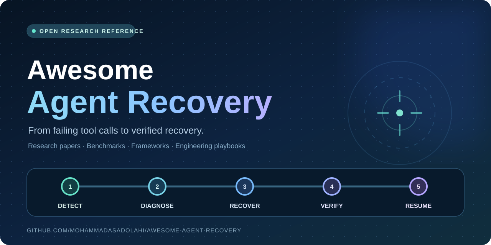
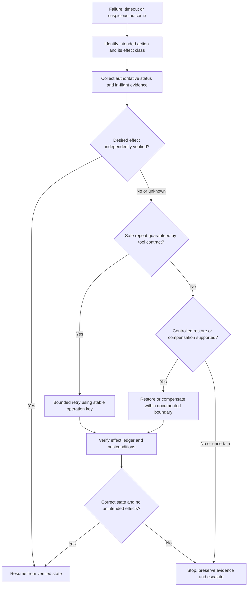

# Awesome Agent Recovery

[](https://awesome.re)
[](https://github.com/MohammadAsadolahi/Awesome-Agent-Recovery/actions/workflows/quality.yml)
[](data/resources.csv)
[](LICENSE)
[](CONTRIBUTING.md)



> **A curated research-to-production reference for AI agent failure recovery.**
> Papers, benchmarks, open implementations and engineering patterns for **detecting failures, choosing safe interventions, restoring state and verifying outcomes** in LLM agents.

**The central question:** *When an AI agent fails, how can it recover useful progress without duplicating, losing or silently corrupting real-world effects?*

**For:** researchers evaluating agent reliability; engineers building tool-using and multi-agent systems; maintainers of durable execution frameworks; safety and evaluation teams.

**Explore:** [Start here](#start-here) · [Find a recovery strategy](#find-a-recovery-strategy) · [Research papers](#research-papers) · [Benchmarks](#benchmarks-and-evaluation) · [Production systems](#production-systems-and-implementation-guides) · [Runnable example](#try-a-failure-injection-example) · [Contributing](#contributing)

> [!IMPORTANT]
> **Agent state is not external truth.** A conversation checkpoint, a successful tool response or a completed workflow is not proof that a payment, booking, message or database mutation was correctly applied. After ambiguous writes, first inspect authoritative state and the tool contract. A retry can be unsafe even after an empty read-back if an earlier request is still in flight.

**Last curated review:** 30 October 2026. The index currently contains **79 resources** (research, benchmark artifacts, engineering guides and related collections). Paper scores are **author-reported** unless expressly identified as independently reproduced. The local example is a **simulation**, not a production transaction engine.

## Contents

- [What this collection covers](#what-this-collection-covers)
- [Start here](#start-here)
- [Find a recovery strategy](#find-a-recovery-strategy)
- [The agent recovery decision flow](#the-agent-recovery-decision-flow)
- [Research papers](#research-papers)
  - [Transactional recovery and side-effect integrity](#transactional-recovery-and-side-effect-integrity)
  - [Failure detection, localization, and diagnosis](#failure-detection-localization-and-diagnosis)
  - [Tool failures, intervention, and self-recovery](#tool-failures-intervention-and-self-recovery)
  - [Checkpointing, restoration, and reversibility](#checkpointing-restoration-and-reversibility)
  - [Multi-agent and security incident recovery](#multi-agent-and-security-incident-recovery)
  - [Verification and honest failure reporting](#verification-and-honest-failure-reporting)
- [Benchmarks and evaluation](#benchmarks-and-evaluation)
- [Production systems and implementation guides](#production-systems-and-implementation-guides)
- [Try a failure-injection example](#try-a-failure-injection-example)
- [Engineering reference](#engineering-reference)
- [Frequently asked questions](#frequently-asked-questions)
- [Related collections](#related-collections)
- [Contributing](#contributing)

## What this collection covers

AI agent recovery means **detecting and diagnosing a failure, selecting an appropriate corrective action, and independently verifying the resulting state before resuming or stopping safely**.

| Recovery layer | Typical failure | Recovery boundary |
| --- | --- | --- |
| **Agent reasoning** | Looping, drift, incorrect tool interpretation | Replanning, error localization, bounded correction |
| **Tool interaction** | Timeout, silent corruption, rate limit, ambiguous response | Tool status, retry/switch/abstain, idempotency |
| **Execution and workspace** | Worker crash, broken files, corrupted GUI state | Durable journal, coordinated checkpoints, restore |
| **External effects** | Committed-but-unacknowledged write, partial transaction, duplicate delivery | Reconciliation, conditional commit, compensation, explicit escalation |
| **Multi-agent and security** | Error propagation, unsafe retrieved instructions, stale shared beliefs | Fault containment, provenance checks, validated reintegration |
| **Evaluation** | Final task score masks duplicate or harmful effects | Fault injection, conditional recovery, side-effect ledger and independent verifier |

**In scope:** failure detection tied to repair; test-time recovery and intervention; recovery benchmarks; state reconciliation, guarded retries, transaction boundaries, rollback and compensation; multi-agent fault containment.

**Out of scope:** generic prompt engineering, agent catalogs without recovery evidence, product claims lacking observable failure modes, and any suggestion that context persistence alone guarantees safe external actions.

## Start here

Choose a reading path based on the problem you are solving.

| If you are asking… | Read first | Why |
| --- | --- | --- |
| **Did the write commit before the timeout?** | [LIMBO / Exactly-Once](https://arxiv.org/abs/2609.29095) · [UndoBench](https://arxiv.org/abs/2610.05622) | Ambiguous acknowledgments, late commits, duplicate effects and recovery-specific metrics |
| **How should effects be isolated, committed or undone?** | [Atomix](https://arxiv.org/abs/2602.14849) · [SagaLLM](https://doi.org/10.14778/3750601.3750611) | Effect classes, settlement boundaries, compensating operations |
| **When should the agent retry, switch or stop?** | [BENCH2ROBUST](https://arxiv.org/abs/2608.11977) · [ReInBench / ReCoF](https://arxiv.org/abs/2610.36471) | Recoverability-aware decisions, unnecessary intervention |
| **Where did the task first go wrong?** | [Traverse](https://arxiv.org/abs/2609.17930) · [AgentRx](https://aclanthology.org/2026.findings-emnlp.598/) | First-error localization with evidence rather than final-score guesses |
| **How do I measure recovery independently of task competence?** | [GUI-RobustEval](https://proceedings.mlr.press/v306/bu26b.html) · [ToolMisuseBench](https://aclanthology.org/2026.realm-1.28/) · [ParaRecover](https://aclanthology.org/2026.emnlp-main.975/) | Controlled recovery cases for GUI, sequential and parallel tool use |
| **What survives process crashes and sandbox damage?** | [AgentRewind](https://arxiv.org/abs/2608.14380) · [Crab](https://arxiv.org/abs/2604.28138) · [production comparison](docs/production-systems.md) | Separates workflow, context, sandbox and external-state persistence |

**Latest research review:** [MCP faults, asynchronous recovery, evaluator alignment, and verification — 30 October 2026](docs/research-update-2026-10-30.md) evaluates 13 papers against prior entries, including exclusions and implementation evidence. Earlier reviews: [transactional recovery](docs/research-update-2026-10-29-transactional.md) and [failure diagnosis](docs/research-update-2026-10-29.md).

### Newly added research: 30 October 2026

| New question | Read first | What it adds |
| --- | --- | --- |
| Does the chosen repair work for the **actual deployed agent**? | [Repairs for Whom?](https://arxiv.org/abs/2610.38610) | Evaluator–executor mismatch and executor-specific rollout evidence |
| Can an agent withstand **realistic MCP faults**? | [MCP-Injector](https://arxiv.org/abs/2610.32555) · [RetryRealistic](https://openreview.net/forum?id=HLCpv21u07) | Seedable protocol faults and sandboxed real-tool tests |
| May a restarted workflow still **exercise authority**? | [Permission to Retry](https://arxiv.org/abs/2610.31916) | Separate dispatch, settlement and reconciliation permissions |
| Can a coordinator use **late subagent results** correctly? | [Async-RBench](https://arxiv.org/abs/2610.32429) · [REVISE](https://arxiv.org/abs/2609.00643) | Preserve valid work, invalidate stale dependencies and reverify |
| Can the system detect a **silent fault or fabricated success**? | [RITE](https://arxiv.org/abs/2610.27777) · [Failure-Transparent Agents](https://arxiv.org/abs/2609.35732) | Independent evidence vs plausible results and unsupported final claims |

## Find a recovery strategy

Use this table to locate the appropriate research **before** applying automated recovery in a real system.

| Failure or uncertainty | First response | Useful references |
| --- | --- | --- |
| **Read-only tool times out** | Capped retries with backoff; validate the returned data | [ToolMaze](https://arxiv.org/abs/2606.05806), [BENCH2ROBUST](https://arxiv.org/abs/2608.11977) |
| **Write times out after dispatch** | Identify the business operation; reconcile status, in-flight uncertainty and idempotency guarantees | [LIMBO](https://arxiv.org/abs/2609.29095), [UndoBench](https://arxiv.org/abs/2610.05622), [field guide](docs/field-guide.md) |
| **Operation partly committed** | Determine committed subset; only compensate or resume the remaining work under supported contracts | [SagaLLM](https://doi.org/10.14778/3750601.3750611), [RAC](https://arxiv.org/abs/2605.03409), [DelAct](https://doi.org/10.1109/IWQoS70441.2026.11661202) |
| **Tool returns a plausible but false value** | Verify source evidence before adopting the value; distinguish silent from explicit errors | [RITE](https://arxiv.org/abs/2610.27777), [Loud Failures, Quiet Failures](https://arxiv.org/abs/2610.10062) |
| **Returned success masks unexpected effects** | Compare actual persistent changes with the authorized outcome | [EffectMatch](https://arxiv.org/abs/2609.31301), [verified tool calls](https://arxiv.org/abs/2608.02645) |
| **Recovered workflow has changed permissions** | Check current dispatch and reconciliation authority separately from the stored checkpoint | [Permission to Retry](https://arxiv.org/abs/2610.31916) |
| **Subagent replies late or provides stale evidence** | Recheck affected dependencies, avoid revising valid work, and re-run necessary assertions | [Async-RBench](https://arxiv.org/abs/2610.32429), [REVISE](https://arxiv.org/abs/2609.00643) |
| **Tool is broken or paths are exhausted** | Classify transient/permanent failure; retry, switch or abstain | [BENCH2ROBUST](https://arxiv.org/abs/2608.11977), [ToolMisuseBench](https://aclanthology.org/2026.realm-1.28/) |
| **Agent repeats or misdiagnoses a mistake** | Locate causal error; intervene only when evidence warrants it | [Traverse](https://arxiv.org/abs/2609.17930), [Sentry](https://arxiv.org/abs/2610.02994), [RESKILL](https://aclanthology.org/2026.emnlp-main.2024/) |
| **GUI state was changed incorrectly** | Inspect inherited state, restore only supported boundaries and verify completion | [CUA-Recovery](https://arxiv.org/abs/2610.27645), [GUI-RobustEval](https://proceedings.mlr.press/v306/bu26b.html), [CUADebug](https://aclanthology.org/2026.findings-emnlp.530/) |
| **Process or sandbox crashed** | Resume journaled steps or restore aligned snapshots; reconcile external effects separately | [Temporal](https://docs.temporal.io/ai), [AgentRewind](https://arxiv.org/abs/2608.14380), [Crab](https://arxiv.org/abs/2604.28138) |
| **Multiple workers propagate bad state** | Quarantine causal sources, correct shared beliefs and retest downstream actions | [DoVer](https://arxiv.org/abs/2512.06749), [DoCtOR](https://aclanthology.org/2026.emnlp-main.335/), [MemTX](https://arxiv.org/abs/2607.23929) |
| **Tool response carries unsafe instructions** | Preserve the original authorized goal; contain injection and validate a safe continuation | [RecoverAgent](https://aclanthology.org/2026.findings-emnlp.830/), [AIR](https://proceedings.mlr.press/v306/xiao26n.html) |
| **Action is irreversible or unobservable** | Stop or escalate; absence of proof is not proof of non-execution | [LIMBO](https://arxiv.org/abs/2609.29095), [field guide](docs/field-guide.md) |

## The agent recovery decision flow

This is an **engineering decision aid**, not an automated safety or exactly-once guarantee.



**Accessible summary:** classify the operation → reconcile authoritative state (including in-flight uncertainty) → use a guaranteed-safe retry, bounded compensation/restore or escalation → verify both task success and side effects → resume only on verified state.

> **Critical limit:** Even a read-back showing “not found” cannot prove that a timed-out operation will never commit later. Late commits and duplicate delivery require stronger contracts such as stable idempotency keys, conditional writes, or a verified terminal operation status.

## Research papers

The selections below are grouped by **what can fail and what can actually be repaired**. Each link points to a canonical publication/preprint. For machine-readable metadata, date, code and limitations, use the [CSV index](data/resources.csv) or [JSON index](data/resources.json).

### Transactional recovery and side-effect integrity

- [Permission to Retry](https://arxiv.org/abs/2610.31916) (2026 preprint) — Tests whether retained state and changed authorization still permit dispatch, reconciliation or reattempt after a crash.
*Safe retries, compensation, commit control, effect verification and durable boundaries.*

- [Where Does Exactly-Once Live? / LIMBO](https://arxiv.org/abs/2609.29095) (2026 preprint) — Service-boundary fault injection with committed-effect ledgers; shows where verification-only retries cannot ensure exactly-once.
- [UndoBench](https://arxiv.org/abs/2610.05622) (2026 preprint) — Separates nominal competence from safe conditional recovery across pre-, mid- and post-mutation fault phases. [Code](https://github.com/tradertanmay/undobench).
- [Atomix](https://arxiv.org/abs/2602.14849) (2026 preprint) — Progress-aware transactional settlement for bufferable, reversible and irreversible tool effects.
- [SagaLLM](https://doi.org/10.14778/3750601.3750611) (PVLDB 2025) — Saga-pattern compensation, persistent context and independent multi-agent validation. [Code](https://github.com/genglongling/SagaLLM).
- [Robust Agent Compensation / RAC](https://arxiv.org/abs/2605.03409) (2026 preprint) — Log-backed compensation around agent tool execution.
- [DelAct](https://doi.org/10.1109/IWQoS70441.2026.11661202) (IWQoS 2026) — Replayable boundary between deliberation and actuation, with governed tool execution and compensation.
- [Beyond Approved Actions / EffectMatch](https://arxiv.org/abs/2609.31301) (2026 preprint) — Matches persistent effects to application approval before commit and downstream continuation.
- [Verified Tool Calls](https://arxiv.org/abs/2608.02645) (2026 preprint) — Postcondition checking, verify-before-retry and idempotency-key wrappers under simulated non-atomic faults.
- [MemTX](https://arxiv.org/abs/2607.23929) (2026 preprint) — Transactional shared-belief writes and cascading repair for dependent agent actions.

**Boundary:** these systems study specific contracts, adapters and controlled testbeds. **Compensation is a new operation**, not an assurance that all consequences of a prior operation disappear.

### Failure detection, localization, and diagnosis

*Evidence about which step actually caused failure, not just which trace ended unsuccessfully.*

- [Locating Hidden Failures / Traverse](https://arxiv.org/abs/2609.17930) (2026) — Dataset and Scout verifier for early causal mistakes.
- [AgentRx](https://aclanthology.org/2026.findings-emnlp.598/) (EMNLP Findings 2026) — Auditable step constraints and violation logs. [Code](https://github.com/microsoft/AgentRx).
- [TRAJDEBUG](https://aclanthology.org/2026.findings-emnlp.437/) (EMNLP Findings 2026) — Distinguishes self-resolved errors from mistakes that persist into final failure. [Code](https://github.com/THU-KEG/TrajDebug).
- [AgentDebugX](https://aclanthology.org/2026.emnlp-demos.52/) (EMNLP Demos 2026) — Detect–attribute–recover–rerun toolkit. [Code](https://github.com/AgentDebugX/AgentDebugX).
- [CUADebug](https://aclanthology.org/2026.findings-emnlp.530/) (EMNLP Findings 2026) — Screenshot/action-grounded diagnosis and controlled computer-use reruns.
- [Causal Decomposition via Oracle-State Intervention](https://aclanthology.org/2026.realm-1.6/) (REALM 2026) — Tests how rarely simply replacing corrupted context repairs failed execution.
- [Real-Time Detection and Repair of LLM Agent Failures](https://arxiv.org/abs/2608.02464) (2026) — Step telemetry and deterministic checks before local repairs.
- [Localizing Emergent Failures via Counterfactual Replay](https://arxiv.org/abs/2608.29228) (2026) — Graph-constrained experiments to identify minimal repair families.
- [DoVer](https://arxiv.org/abs/2512.06749) (2025 preprint, revised 2026) — Tests multi-agent debugging hypotheses through interventions.
- [Survey for LLM Agent Trajectory Analysis](https://doi.org/10.1109/TSE.2026.3717765) (2026) — Broader background in tracing, diagnosis and failure attribution.

### Tool failures, intervention, and self-recovery

- [Tool-Calling LLM Agents Under Realistic MCP Faults / MCP-Injector](https://arxiv.org/abs/2610.32555) (2026 preprint; authors report NeurIPS 2026 acceptance) — Injects seeded persistent/transient/intermittent MCP failures derived from public ecosystem issue evidence. [Code and data](https://gitlab.com/uniluxembourg/snt/sedan/papers/mcp-injector).
- [RITE: Evaluating End-to-End Resilience to Silent Tool Errors](https://arxiv.org/abs/2610.27777) (2026 preprint) — Matched explicit failures and plausible-but-wrong results test recognition, verification and eventual task outcome.
- [Loud Failures, Quiet Failures](https://arxiv.org/abs/2610.10062) (2026 preprint) — Tracks noticing, replanning, looping and task recovery separately across injected faults.
- [Agent-Reflex](https://arxiv.org/abs/2610.17953) (2026 work-in-progress preprint) — Perturbation-grounded reflection skills and recovery-oriented training for tool noise and user corrections. [Code, weights and datasets](https://github.com/RUC-NLPIR/Agent-Reflex).

*Choosing a bounded corrective action and verifying the repair attempt.*

- [When Tools Fail / ToolMaze](https://arxiv.org/abs/2606.05806) (2026) — Explicit/implicit, temporary/persistent tool failures and dynamic replanning. [Code](https://github.com/Zhudongsheng75/ToolMaze).
- [Retry, Switch, or Abstain? / BENCH2ROBUST](https://arxiv.org/abs/2608.11977) (2026 preprint) — Fault-conditioned policy learning and safe stopping when alternatives are exhausted.
- [When to Intervene? / ReInBench / ReCoF](https://arxiv.org/abs/2610.36471) (2026 preprint) — Detects when natural self-recovery makes external intervention unnecessary.
- [Sentry](https://arxiv.org/abs/2610.02994) (2026) — Conditional test-time recovery guidance, external monitoring and verification. [Project](https://github.com/BLIMP-B/sentry).
- [RESKILL](https://aclanthology.org/2026.emnlp-main.2024/) (EMNLP 2026) — Failure hypotheses, targeted skill patches and feedback-driven retesting.
- [Debugging the Debuggers / PROBE](https://arxiv.org/abs/2605.08717) (2026) — Evidence-gated recovery guidance after engineering-agent failures.
- [Agent Error Dataset](https://arxiv.org/abs/2609.40111) (2026 preprint) — Error–diagnosis pairs and matched correction replays where the environment can be reset.
- [Reflexion](https://arxiv.org/abs/2303.11366) (2023) — Verbal feedback across attempts; a foundation, **not** remote transaction recovery.

### Checkpointing, restoration, and reversibility

- [REVISE: Validity-Guided Recovery for Online Revisions](https://arxiv.org/abs/2609.00643) (2026 preprint) — Tracks workflow dependencies to preserve valid completed work after instruction revisions while recomputing affected branches.

*What can be rolled back, how much progress survives and which effects remain outside a snapshot.*

- [AgentRewind](https://arxiv.org/abs/2608.14380) (2026) — Aligned agent/context and environment checkpoints for engineering agents.
- [Crab](https://arxiv.org/abs/2604.28138) (2026) — Semantics-aware snapshot and restore for controlled sandboxes.
- [Back Up Before You Regret / RegretBench](https://arxiv.org/abs/2610.28934) (2026) — Preventive backup awareness for coding agents.
- [Speculative Rollback Correction](https://arxiv.org/abs/2606.12485) (2026) — Branch correction in resettable web-agent training environments. [Code](https://github.com/LongkunHao/SRC_gui_agent).
- [Self-Healing Harness for Agent Self-Modification](https://arxiv.org/abs/2609.24130) (2026) — Regression gates for executable self-modifications.

### Multi-agent and security incident recovery

- [When Messages Go Wrong](https://arxiv.org/abs/2610.15459) (2026 preprint) — Tests message loss, delay and partial content and compares evidence-preserving multi-agent architectures. [Code and artifacts](https://github.com/SonGoKu21/mas_communication).
- [Async-RBench](https://arxiv.org/abs/2610.32429) (2026 preprint) — Executable asynchronous result-delivery scenarios, including stale updates, duplicates and failed subagents. [Code](https://github.com/pope8zdt/Async-RBench).

*Containing failures before they spread through shared plans, memory or permissions.*

- [MeshHeal](https://arxiv.org/abs/2609.29015) (2026) — Multi-timescale containment and reintegration for gray faults in agent networks.
- [Collective Loss of Control](https://arxiv.org/abs/2609.18460) (2026) — Studies propagation and recovery of deviations across agent systems.
- [Finding Where the Buck Stops / DoCtOR](https://aclanthology.org/2026.emnlp-main.335/) (EMNLP 2026) — Locates the decisive error agent and targets corrective reflection.
- [RecoverAgent](https://aclanthology.org/2026.findings-emnlp.830/) (EMNLP Findings 2026) — Safely continues the legitimate task after indirect prompt-injection detection.
- [AIR: Improving Agent Safety through Incident Response](https://proceedings.mlr.press/v306/xiao26n.html) (ICML 2026) — Detects, contains and remediates incidents, then synthesizes future guardrails.
- [Safety Must Survive Self-Improvement](https://arxiv.org/abs/2610.01073) (2026 preprint) — Revalidates and rolls back unsafe persistent agent revisions.
- [EpiSEM-Bench](https://arxiv.org/abs/2610.31650) (2026 preprint) — Tests recovery of missing safety-relevant evidence before tool actions.

### Verification and honest failure reporting

*Distinguish verified effects, correctly diagnosed uncertainty, and unsupported success claims.*

- [Failure-Transparent Agents](https://arxiv.org/abs/2609.35732) (2026 preprint) — Measures false-success and fabricated-detail statements after controlled failed tool observations; tests a structured evidence contract.
- [When Tools Fail, Agents Fabricate / RetryRealistic](https://openreview.net/forum?id=HLCpv21u07) (NeurIPS 2026 workshop, per authors) — Sandbox file, SQLite and HTTP faults scored as correct, fabricated or honest failure. [Runnable testbed](https://github.com/Kingsford-Group/RetryRealistic).

A low fabricated-success rate improves **reporting calibration**; it does not by itself show that any failed tool operation was repaired. A monitor triggered only by explicit errors may still miss silent corruption.

For foundational reasoning/action design, see [ReAct](https://arxiv.org/abs/2210.03629). It is a foundation for agent tool use, **not** a recovery safety primitive.

## Benchmarks and evaluation

**New evaluation caution:** [Repairs for Whom?](https://arxiv.org/abs/2610.38610) shows repair rankings can change with the executor used for scoring. Verify selected repairs on the **deployed policy**, not solely on a more capable judge. [SSCBench](https://arxiv.org/abs/2610.11514) adds a second caution: a fault-injection case should be credited with available counterevidence only if that evidence could reach the agent **before first erroneous use**. Both are evaluation-validity questions, not automatic recovery mechanisms.

A recovery benchmark should expose failures that a clean-run task score would hide. A **diagnosis score** is not a **repaired-task score**; neither is evidence of **correct external effects**.

| Benchmark | Evaluates | Important limitation |
| --- | --- | --- |
| [Repairs for Whom?](https://arxiv.org/abs/2610.38610) | Executor-dependent choice of effective repair step | ALFWorld/WebShop experiments; executor mismatch changes rankings |
| [MCP-Injector](https://arxiv.org/abs/2610.32555) | Protocol-aware MCP tool faults with persistence schedules | Two backbone sizes; do not extrapolate model-scale claim |
| [Async-RBench](https://arxiv.org/abs/2610.32429) | Late/stale/duplicate subagent outcomes and necessary revalidation | Dynamic Replanning Score differs from task success |
| [AndroidFlux](https://arxiv.org/abs/2610.34384) | Mobile recovery from aligned AndroidWorld checkpoints | Controlled device snapshots and offline reward comparisons |
| [RITE](https://arxiv.org/abs/2610.27777) | Silent tool errors versus explicit errors and clean tool values | E-commerce workflows with frozen tool behavior |
| [SSCBench](https://arxiv.org/abs/2610.11514) | Whether timely counterevidence existed before faulty reliance | Evidential-validity measurement, not repaired outcomes |
| [RetryRealistic](https://openreview.net/forum?id=HLCpv21u07) | Real sandbox tools with honest-failure/fabrication outcome labels | Monitor requires signaled error to activate; sandbox only |
| [LIMBO](https://arxiv.org/abs/2609.29095) | Duplicate writes, late commits, delivery semantics, effect ledgers | Sandbox/contract-specific |
| [UndoBench](https://arxiv.org/abs/2610.05622) | Nominal competence vs conditional recovery, duplicate/missing effect rates | Paired enterprise simulations |
| [GUI-RobustEval](https://proceedings.mlr.press/v306/bu26b.html) | Recovery from GUI policy mistakes | Controlled executable tasks |
| [ToolMisuseBench](https://aclanthology.org/2026.realm-1.28/) | Deterministic tool fault recovery | Frozen offline fault plans |
| [ParaRecover](https://aclanthology.org/2026.emnlp-main.975/) | Parallel tool errors and causal replanning | Process-level, not transaction safety |
| [BENCH2ROBUST](https://arxiv.org/abs/2608.11977) | Retry vs alternative tool vs abstention | Scenario-controlled solvability |
| [Recovery-Bench](https://openreview.net/forum?id=8FZRnDgDxq) | Inherited failed trajectories and polluted context | Submission; external effects not necessarily scored |
| [CUA-Recovery](https://arxiv.org/abs/2610.27645) | Inherited persistent computer-use errors | Awareness and completion differ |
| [ReInBench](https://arxiv.org/abs/2610.36471) | When to intervene vs self-recover | Intervention can do harm |
| [ToolMaze](https://arxiv.org/abs/2606.05806) | Dynamic replanning under tool faults | Fault classes vary |
| [RegretBench](https://arxiv.org/abs/2610.28934) · [MettleBench](https://arxiv.org/abs/2608.14380) | Backup readiness and recoverable controlled work | Not remote service rollback |
| [AgentChaosBench](https://arxiv.org/abs/2608.14680) · [TrajErrBench](https://aclanthology.org/2026.findings-emnlp.437/) | Runtime fault diagnosis and error lifecycle | Localization alone does not repair |

**Recommended reporting:** normal-task pass rate; fault detection and localization; conditional recovery among nominally capable runs; duplicate/missing side effects; authoritative postcondition verification; safe abstention; latency/cost; collateral damage; testbed and restart assumptions.

**Important negative finding:** [Same Winners, Different Success Rates](https://arxiv.org/abs/2609.34215) shows why action-ranking agreement can obscure near-zero recovery success. Report absolute recovery and all-zero fractions alongside agreement. See the [full evaluation guide](docs/benchmarks.md).

## Production systems and implementation guides

These are **documented persistence and orchestration primitives**, not interchangeable correctness guarantees.

| System | Helps recover | Must still be handled explicitly |
| --- | --- | --- |
| [Temporal](https://docs.temporal.io/ai) · [AI Cookbook](https://docs.temporal.io/ai/cookbook) | Durable workflow progress, activities, waits and retries | External side effects and idempotency |
| [Inngest](https://www.inngest.com/docs/durable-execution/durable-agents) | Durable steps, waits and reruns | Duplicate effects on downstream tools |
| [DBOS](https://docs.dbos.dev/python/examples/hacker-news-agent) | Database-backed workflow state | Third-party transaction boundaries |
| [Restate](https://github.com/restatedev/restate) | Journaled durable service operations | Arbitrary remote effects |
| [LangGraph](https://github.com/langchain-ai/docs/blob/main/src/oss/langgraph/persistence.mdx) | Agent-thread checkpoints and interrupts | Filesystem and application-world restoration |
| [Pydantic AI](https://pydantic.dev/docs/ai/capabilities/durable_execution/overview/) | Durable execution backend integrations | Backend-specific semantics |
| [OpenAI Agents SDK Sessions](https://openai.github.io/openai-agents-python/sessions/) | Conversation and session continuity | Crash-safe external writes |

See [production recovery boundaries](docs/production-systems.md) for practical evaluation questions before choosing a stack.

## Try a failure-injection example

The dependency-free example simulates a remote write that **commits**, then loses its response. A blind retry duplicates the effect; reconciliation with an operation key avoids it under the simulator's contract.

```bash
python examples/ambiguous_write_demo.py
python -m unittest discover -s tests
python scripts/validate.py
```

Expected simulation: **two writes** with blind retry, versus **one write** with a stable key and reconciliation. This example makes **no real payments or API calls** and does not prove exactly-once semantics for arbitrary external systems.

## Engineering reference

| Resource | What it provides |
| --- | --- |
| [Documentation index](docs/README.md) | Where to go for each engineering or research task |
| [Recovery field guide](docs/field-guide.md) | Failure classes, reconciliation and escalation |
| [Benchmark and evaluation protocol](docs/benchmarks.md) | Fault injection and non-conflated metrics |
| [Production systems](docs/production-systems.md) | Workflow, context, sandbox and remote-effect boundaries |
| [30 October 2026 evidence review](docs/research-update-2026-10-30.md) | New fault, evaluator-alignment, asynchronous, and truthful-reporting studies |
| [Transactional recovery research review](docs/research-update-2026-10-29-transactional.md) | 22 newly curated sources, synthesis and limits |
| [Earlier research review](docs/research-update-2026-10-29.md) | Diagnostic and recovery research curation |
| [Scope and evidence policy](docs/research-decision.md) | Inclusion criteria and source hierarchy |
| [Resource index (CSV)](data/resources.csv) · [JSON](data/resources.json) | Structured metadata, URLs and caveats |
| [FAQ](docs/faq.md) · [llms.txt](llms.txt) | Definitions and machine-readable navigation |

## Frequently asked questions

**What is AI agent failure recovery?** Detecting a failed or suspicious agent outcome, diagnosing it, selecting a safe corrective action and **verifying actual state** before continuing or stopping.

**Can agents just retry failed tool calls?** Read-only or contractually idempotent operations are often retryable with bounds. An effectful timeout is ambiguous: the remote write may already have committed or still be in flight. See [LIMBO](https://arxiv.org/abs/2609.29095) and the [field guide](docs/field-guide.md).

**Does checkpointing undo external effects?** No. A checkpoint may restore local conversation, workflow or sandbox state while external writes remain committed. Compensation and reconciliation have separate preconditions.

**How can I compare recovery models?** Compare failures on the same tasks and fault schedules. Report **conditional recovery**, independent postconditions and duplicate/collateral effects; do not combine incomparable benchmarks into a universal ranking.

**Does root-cause localization guarantee recovery?** No. Causal diagnosis identifies a likely repair target. A correct and safe rerun must be demonstrated independently.

See [all frequently asked questions](docs/faq.md).

## Related collections

- [Awesome Agent Reliability](https://github.com/swarmproof/awesome-agent-reliability) — broad operational resilience.
- [Awesome Agent Trajectory](https://github.com/YintongHuo/awesome-agent-trajectory) — trajectory tracing and debugging.
- [Awesome LLM Agent Trajectory Analysis](https://github.com/IcyFeather233/Awesome-LLM-Agent-Trajectory-Analysis) — survey-oriented trajectory research.
- [Awesome Agent Harness](https://github.com/Gloriaameng/Awesome-Agent-Harness) — runtime and harness patterns.
- [Awesome AgentOps](https://github.com/natnew/awesome-agentops) — broader agent observability.

## Contributing

Contributions are welcome when they improve the **failure mode → evidence → recovery action → verification** chain. Before proposing a paper or implementation:

1. Check for duplicates and alternate preprint/published versions in [the catalog](data/resources.csv).
2. Cite the canonical source, publication status and (when available) original code or benchmark.
3. Describe **what failed**, **what was corrected**, **what state changed**, **how it was verified** and **what is not guaranteed**.
4. Update the CSV source of truth, regenerate JSON using `python scripts/validate.py --sync-json`, and run the checks.

Read [CONTRIBUTING.md](CONTRIBUTING.md) and the [evidence policy](docs/research-decision.md) before filing a PR.

If this reference helps your work, consider [starring the repository](https://github.com/MohammadAsadolahi/Awesome-Agent-Recovery) or [suggesting a resource](https://github.com/MohammadAsadolahi/Awesome-Agent-Recovery/issues/new/choose).

**License:** Original curation metadata is [CC0-1.0](LICENSE). Linked papers, software and documentation retain their respective licenses.
